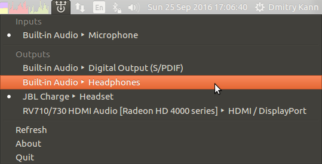

[](https://github.com/yktoo/indicator-sound-switcher/releases/latest)
[](https://github.com/yktoo/indicator-sound-switcher/actions/workflows/test.yml)
[](COPYING)

# Sound Switcher Indicator

Sound input/output selector application for Linux.

It shows an icon in the indicator area or the system tray (whatever is available in your desktop environment). The icon's menu allows you to switch the current sound input and output (i.e. *source ports* and *sink ports* in PulseAudio's terms, respectively) with just two clicks:



The application makes use of the native PulseAudio API, so it works both with PulseAudio and with PipeWire (via its PulseAudio compatibility layer, `pipewire-pulse`).

For details see:
* http://yktoo.com/en/software/indicator-sound-switcher/ (English)
* http://yktoo.com/ru/software/indicator-sound-switcher/ (русский)


## Features

* Switch between input and output ports of all sound devices — speakers, headphones, HDMI/DisplayPort, S/PDIF, USB and Bluetooth headsets etc. — right from the tray menu.
* Automatically picks a card profile that supports the selected port, or a preferred profile you configure.
* Rename devices and ports, hide the ones you never use, or keep a port in the menu even when it's reported as unavailable.
* Hide the whole *Inputs* or *Outputs* section of the menu.
* Global keyboard shortcuts for switching to a specific port.
* Reacts to devices being plugged in or removed, and reconnects automatically when the sound server restarts.
* Starts automatically on login.
* Translated into a number of languages.


## Installation

See the [installation instructions](doc/install.md). In short, the application is available:

* For Ubuntu and derivatives, from the PPA:

      sudo add-apt-repository ppa:yktooo/ppa
      sudo apt-get update
      sudo apt-get install indicator-sound-switcher

* As a snap on any distribution supporting [Snap](https://snapcraft.io/indicator-sound-switcher):

      sudo snap install indicator-sound-switcher

Once installed, the indicator starts automatically after you log in. You can also launch it from the applications menu, or from the command line by running `indicator-sound-switcher`.

### Requirements

* A desktop environment with a tray/indicator area supporting the [StatusNotifierItem](https://www.freedesktop.org/wiki/Specifications/StatusNotifierItem/) protocol. On **GNOME Shell** this requires the [AppIndicator and KStatusNotifierItem Support](https://extensions.gnome.org/extension/615/appindicator-support/) extension (preinstalled on Ubuntu). KDE Plasma, Xfce, Cinnamon, MATE, Budgie and others support it out of the box.
* PulseAudio or PipeWire with `pipewire-pulse`.


## Usage

Click the icon and pick an input or output port from the menu; the currently active ports are marked. The menu only lists ports that are available at the moment (e.g. *Headphones* only shows up when headphones are plugged in), unless configured otherwise.

The *Preferences…* menu item opens a dialog that lets you customise the menu and assign keyboard shortcuts.

### Keyboard shortcuts

A global keyboard shortcut can be assigned to any port in the *Devices* tab of the Preferences dialog (or via the [configuration file](doc/config.md)). Pressing it switches to that port.

* On **X11**, shortcuts are handled by the Keybinder library (package `gir1.2-keybinder-3.0`, recommended by the Debian package and bundled with the snap).
* On **Wayland**, shortcuts are registered through the XDG Desktop Portal's `GlobalShortcuts` interface, if your desktop provides it. The configured key combo is only a *preferred* trigger there: the desktop may ask you to confirm it or let you assign a different one in its own settings.

### Command-line options

| Option      | Description                                                     |
|-------------|-----------------------------------------------------------------|
| `-v`        | Verbose output: also print `INFO` messages.                     |
| `-vv`       | Even more verbose output: print all messages including `DEBUG`. |
| `--version` | Print the application version and exit.                         |

Only one instance of the indicator can run at a time.


## Documentation

* [Installation](doc/install.md)
* [Configuration](doc/config.md) — the Preferences dialog and the JSON configuration file
* [Localisation](doc/i18n.md) — how to update or add a translation
* [Changelog](debian/changelog)


## Bug reporting

Run the application in verbose mode to see the detailed log (quit the running instance first):

    indicator-sound-switcher -vv

and, once the error condition has been reproduced, [file a bug report](https://github.com/yktoo/indicator-sound-switcher/issues) and attach the output to it.


## For developers

### Dependencies

The application is written in Python 3 and uses GTK 3 and AppIndicator through GObject Introspection, so its dependencies are system packages rather than pip ones. On Debian/Ubuntu:

```bash
sudo apt-get install python3-gi gir1.2-gtk-3.0 gir1.2-ayatanaappindicator3-0.1 libpulse0 \
    gir1.2-keybinder-3.0 python3-setuptools python3-pytest gettext
```

`gir1.2-keybinder-3.0` is optional (global shortcuts on X11), and the older `gir1.2-appindicator3-0.1` can be used instead of `gir1.2-ayatanaappindicator3-0.1`.

### Running from the source tree

The app reads its version from the package metadata, so generate it once (and again after changing the version in `setup.py`):

```bash
python3 setup.py egg_info --egg-base lib
```

Then run the application without installing it:

```bash
PYTHONPATH=lib python3 -m indicator_sound_switcher -vv
```

Only a single instance can run at a time, so quit any installed copy that's already running (e.g. the autostarted one) first.

### Debugging

With `-vv` the application logs the whole PulseAudio event flow: cards, sinks, sources and their ports being added or removed, subscription events, profile and port switches, keyboard shortcut binding and so on. That's the main tool for verifying a change: run the app with `-vv`, perform the relevant action (plug a device in, pick a port in the menu, press a shortcut, restart the sound server with `pulseaudio -k` or `systemctl --user restart pipewire-pulse`), and watch the log.

The debug output also shows the card and port names used in the [configuration file](doc/config.md).

Note that the application rewrites its configuration file `~/.config/indicator-sound-switcher.json` on exit, so only edit it while the app isn't running.

### Tests

Unit tests live in `tests/` and use pytest. They import the real package, so they need the dependencies above and the generated package metadata (see [Running from the source tree](#running-from-the-source-tree)):

```bash
python3 -m pytest
```

The tests are also run by GitHub Actions on every push and pull request.

### Code layout

* `lib/indicator_sound_switcher/` — the Python package:
    * `indicator.py` — the indicator itself: PulseAudio connection and event handling, menu building.
    * `card.py`, `stream.py`, `port.py` — the object model of PulseAudio cards, sinks/sources and their ports.
    * `config.py` — configuration handling and global keyboard shortcuts.
    * `prefs.py`, `prefs.glade` — the Preferences dialog.
    * `lib_pulseaudio.py` — ctypes bindings for `libpulse`, generated from the libpulse headers (don't edit by hand).
* `po/` — translations; see [Localisation](doc/i18n.md) for updating the translation template.
* `debian/` — Debian packaging.
* `snap/` — Snap packaging.
* `icons/`, `man/`, `com.yktoo.IndicatorSoundSwitcher.desktop` — icons, the man page and the desktop entry.

### Building and packaging

The application version is defined in a single place: `APP_VERSION` in `setup.py`.

**Python package.** `setup.py` uses setuptools; it also compiles the `.po` translations into `.mo` files.

**Debian package.** Install the build tools first:

```bash
sudo apt-get install devscripts debhelper dh-python
```

The `build_package` script builds a source tarball and a Debian source package in `dist/` (the top entry in `debian/changelog` must match the version in `setup.py`):

```bash
./build_package       # Signed source package, ready for uploading to a PPA
./build_package -b    # Unsigned binary .deb, for local testing
```

**Snap.** Requires `snapcraft` (`sudo snap install snapcraft --classic`):

```bash
snapcraft clean && snapcraft pack
```

Snapcraft builds the snap in an LXD container (you need to be in the `lxd` group). If Docker is installed on the same machine, the build may fail early with `A network related operation failed in a context of no network access`: Docker sets the iptables `FORWARD` policy to `DROP`, which blocks the container's traffic going out through the LXD bridge. You can check this with `sudo iptables -S FORWARD`; if it prints `-P FORWARD DROP`, allow the LXD bridge traffic in Docker's `DOCKER-USER` chain:

```bash
sudo iptables -I DOCKER-USER -i lxdbr0 -j ACCEPT
sudo iptables -I DOCKER-USER -o lxdbr0 -m conntrack --ctstate RELATED,ESTABLISHED -j ACCEPT
```

These rules don't survive a reboot; to make them permanent, install `iptables-persistent` and run `sudo netfilter-persistent save`. If the failed build left a broken base instance behind, delete it (`lxc --project snapcraft list` shows it) before building again.

### Making a release

Publishing requires upload rights to the [PPA](https://launchpad.net/~yktooo/+archive/ubuntu/ppa) and the [Snap Store](https://snapcraft.io/indicator-sound-switcher) entry. Log into the Snap Store once, with your Ubuntu One account:

```bash
snapcraft login
```

Then, for each release:

1. Update `APP_VERSION` in `setup.py`.
2. Add the change info to `debian/changelog` (`dch -v <VERSION>-1`).
3. Run `./build_package` to build the source tarball and the Debian source package.
4. Run the `dput` command printed by `build_package` to upload the package to the PPA.
5. Build the snap: `snapcraft clean && snapcraft pack`.
6. *Optional:* upload the snap: `snapcraft upload --release=stable indicator-sound-switcher*.snap`. This will only upload your current arch version; in order to publish all available versions, navigate to https://snapcraft.io/indicator-sound-switcher/builds and trigger a new build from GitHub. Then click the Releases tab and *promote* the created `edge` packages to `stable`.

#### Important note about the PPA

Launchpad doesn't seem to accept plaintext and/or anonymous FTP uploads via `dput` anymore. To fix that, edit the `[ppa]` section in the file `/etc/dput.cf`:

```conf
[ppa]
fqdn     = ppa.launchpad.net
method   = sftp              # Use SFTP
incoming = ~%(ppa)s
login    = yktooo            # Your Launchpad username here
```

#### Supported architectures

The snap package is only made available for:
* `amd64`
* `arm64`
* `armhf`

There's no `gnome` extension from Canonical for `i386`, `ppc64el`, or `s390x`, hence no indicator build either.

### Why libayatana-appindicator (and not libayatana-appindicator-glib)

The application uses the GTK 3 `libayatana-appindicator3` library (falling back to the older `libappindicator3`) to display its icon and menu. `libayatana-appindicator3` is officially deprecated in favour of `libayatana-appindicator-glib`, however the latter exports the indicator menu only via the `org.gtk.Menus` D-Bus interface, whereas most tray hosts — including GNOME Shell's AppIndicator extension and KDE Plasma — expect the `com.canonical.dbusmenu` interface. With `libayatana-appindicator-glib` the icon would still appear, but its menu wouldn't work on those desktops.

The application therefore sticks to `libayatana-appindicator3` for the time being.

### Contributing

Pull requests are welcome at [GitHub](https://github.com/yktoo/indicator-sound-switcher/pulls). Please match the existing code style (column-aligned assignments; see the PEP8 exceptions listed in `lib/indicator_sound_switcher/__init__.py`), and make sure the tests pass.
